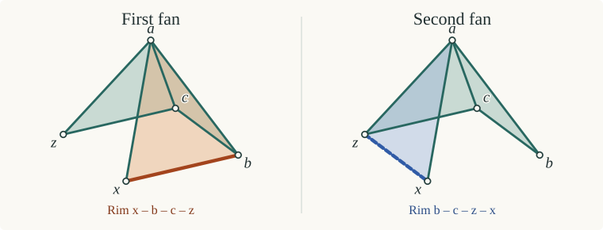

# Tuza's inequality at maximum average degree 15/2

For a finite simple graph $G$, let $\nu(G)$ be the maximum number of edge-disjoint triangles and $\tau(G)$ the minimum number of edges meeting every triangle. Let $H(G)$ be induced by the vertices of degree at least eight in $G$.

| Result | Statement |
| --- | --- |
| A. Maximum average degree | If mad(G) ≤ 15/2, then $\tau(G)\le 2\nu(G)$. The endpoint uses Kandasamy’s Theorem 1.1. |
| B. Triangle-free high subgraph | If $H(G)$ contains no triangle, then $\tau(G)\le 2\nu(G)$. Degrees and triangle multiplicities elsewhere are unrestricted. |
| C. Two high fans | If $\tau(G)>2\nu(G)$, then $H(G)$ contains two copies of $K_1\vee P_4$ with distinct seven-edge sets. They may overlap, including on all five vertices. |

**Status:** internally reviewed, not peer reviewed. The unrestricted conjecture is open. The proofs use published reductions, cited preprints and finite local certificates. [Paper (PDF)](paper/manuscript.pdf) · [Proof guide](PROBLEM_AND_PROOF.md) · [Detailed proofs](canonical/README.md) · [Claims and dependencies](CLAIMS_EVIDENCE_MATRIX.md)

## Two high fans on the same five vertices

The four spokes from *a* and the rim edges *bc* and *cz* are shared. Exchanging *xb* for *xz* changes the seven-edge set counted by Theorem C. To rotate the diagram, download the HTML file and open it in a browser. It works offline. [Interactive 3D figure](visuals/high-fans.html)

## Further results

A simultaneous-avoidance statement on four path edges would imply Tuza’s conjecture. Its universal conclusion remains open. A separate exact census through ten vertices confirms an earlier July computation that the only positive tight triangle-connected supports in this range are $K_4$ and $K_5$. [Statements and scope](PROBLEM_AND_PROOF.md#further-results) · [Replay instructions](REPRODUCIBILITY.md)

## Verify and cite

Run `bash scripts/verify.sh` from a checkout for integrity and the exact replay through order nine. The order-ten computation is available separately. [Reproducibility](REPRODUCIBILITY.md) · [Repository contents](MANIFEST.md) · [Timestamp evidence](PROVENANCE.md)

Use **DannyExperiments** for the preferred citation. [Citation metadata](CITATION.cff) · [Citation status](CITATION_STATUS.md) · [AI disclosure](AI_DISCLOSURE.md) · [Rights and data licenses](LICENSE_STATUS.md)
