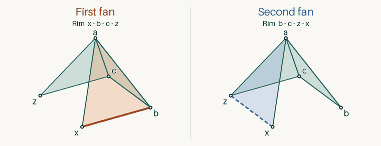

# Tuza's inequality for maximum average degree at most 7.5 (= 15/2)

For a finite simple graph $G$, let $\nu(G)$ be the maximum number of edge-disjoint triangles and $\tau(G)$ the minimum number of edges meeting every triangle. Let $H(G)$ be induced by the vertices of degree at least eight in $G$.

| Result | Statement |
| --- | --- |
| A. Maximum average degree | If mad(G) ≤ 7.5 (= 15/2), then $\tau(G)\le 2\nu(G)$. The strict bound uses Kandasamy’s local Lemma 3.5. Equality also uses his Theorem 1.1. |
| B. Triangle-free high subgraph | If $H(G)$ contains no triangle, then $\tau(G)\le 2\nu(G)$. Degrees and triangle multiplicities elsewhere are unrestricted. |
| C. Two high fans | If $\tau(G)>2\nu(G)$, then $H(G)$ contains two copies of $K_1\vee P_4$ with distinct seven-edge sets. They may overlap, including on all five vertices. |

**Status:** internally reviewed, not peer reviewed. The unrestricted conjecture is open. The proofs use published reductions, cited preprints and finite local certificates. [Paper (PDF)](paper/manuscript.pdf) · [Proof guide](PROBLEM_AND_PROOF.md) · [Detailed proofs](canonical/README.md) · [Claims and dependencies](CLAIMS_EVIDENCE_MATRIX.md)

## Two high fans on the same five vertices

Both fans use the four spokes from *a* and the rim edges *bc* and *cz*. Follow *x* as the diagram turns. Its rim edge goes to *b* in the first fan and to *z* in the second. That single exchange gives the two different seven-edge sets counted by Theorem C. [Rotate the figure yourself](https://dannyexperiments.github.io/tuza-max-average-degree-7.5/visuals/high-fans.html) · [Still image](visuals/high-fans.svg)

## Further results

A simultaneous-avoidance statement on four path edges would imply Tuza’s conjecture. Its universal conclusion remains open. A separate exact census through ten vertices confirms an earlier July computation that the only positive tight triangle-connected supports in this range are $K_4$ and $K_5$. [Statements and scope](PROBLEM_AND_PROOF.md#further-results) · [Replay instructions](REPRODUCIBILITY.md)

## Verify and cite

Run `bash scripts/verify.sh` from a checkout for integrity and the exact replay through order nine. The order-ten computation is available separately. [Reproducibility](REPRODUCIBILITY.md) · [Repository contents](MANIFEST.md) · [Timestamp evidence](PROVENANCE.md)

Cite the November 21, 2026 preprint as **DannyExperiments**, version 1.0.0. [Version DOI](https://doi.org/10.5281/zenodo.24429313) · [Citation metadata](CITATION.cff) · [Archive record](CITATION_STATUS.md) · [AI disclosure](AI_DISCLOSURE.md) · [Rights and data licenses](LICENSE_STATUS.md)
